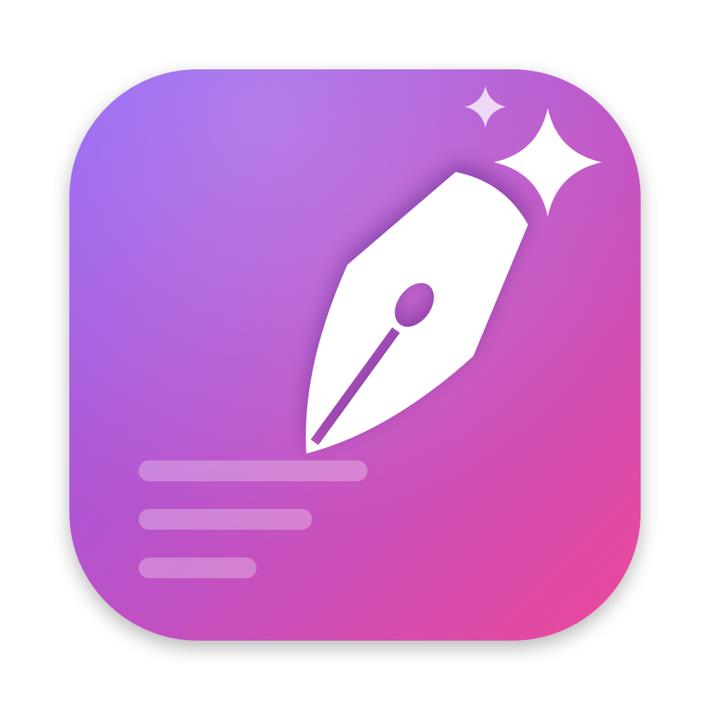
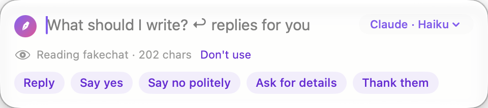

<p align="center"></p>

<h1 align="center">Penlight</h1>

<p align="center"><b>Writes the reply for the box you're typing in, from what's on screen.</b><br>
A small Mac menu-bar app. Works in any app: Mail, Slack, Messages, WhatsApp, browsers, notes.</p>

<p align="center"></p>

## How it works

1. Click into any text box. A small ✒️ button appears beside it (or press **⌃⌥Space**).
2. Say what you want, such as "say yes, but Friday instead", or pick a chip like **Reply** or **Polish**. Then press **↩**.
3. Penlight reads the conversation above the box, writes the text with the AI you chose, and puts it in the box.

If the box already has text, Penlight rewrites it ("Polish", "Shorter", "More formal" and so on). If you selected some text, only that part is replaced. Press ⌘Z in the app to undo.

## Pick your AI

Use whichever AI you already have. You can switch any time from the menu bar or the writing box.

| AI | What you need |
|---|---|
| **Claude Code** | [Claude Code](https://claude.com/claude-code) installed and signed in. No key. |
| **Apple Intelligence** | macOS 26 with Apple Intelligence on. Runs on your Mac. |
| **Anthropic API** | An Anthropic API key |
| **OpenAI (ChatGPT models)** | An OpenAI API key |
| **Google Gemini** | A Gemini API key |
| **OpenRouter** | One key for many models (Perplexity, Grok, Mistral and others) |
| **Ollama** | Ollama running on your Mac. No key, nothing leaves your Mac. |
| **OpenAI-compatible server** | LM Studio, a llama.cpp server, or any `/v1/chat/completions` address |

Chat apps like ChatGPT and Claude Desktop don't let other apps use them. **Settings › AI** shows each one you have and the matching way to the same AI.

## Privacy

- **Nothing is sent until you press ↩.** Then the screen text, your draft and your instruction go **only** to the AI you picked. With Apple Intelligence or Ollama, it all stays on your Mac.
- Click **"Reading … chars"** in the writing box to see exactly what will be sent, or **Don't use** to leave the screen out.
- **API keys are kept in your Mac's Keychain.** They aren't stored in files and are sent only to their own provider.
- **Claude Code** uses your existing Claude Code sign-in. Penlight starts it with no tools, no plugins and no MCP servers, so it can only write text.
- Penlight works in every app you can type in: chat apps, mail, browsers, editors, launchers and terminals. Password fields are always skipped, and password managers start switched off. **Settings › Apps** lists every app on your Mac with an on/off switch.
- In a terminal (Terminal, iTerm2, Ghostty, Warp, kitty, Alacritty, WezTerm) it reads the recent output and writes a command at the prompt: **Next command**, **Fix the last error** or **Undo that**. It never presses Return for you.
- There's no analytics and no account. Penlight never logs screen text.

## Permissions

- **Accessibility** (needed): lets Penlight see which box you're in, read the text around it, and paste into it.
- **Screen Recording** (optional): only for apps that hide their text from Accessibility. Penlight reads the window's pixels on your Mac with Apple's text recognition.

## Install

Download **Penlight.dmg** from [Releases](https://github.com/Sravankumartangudu/penlight/releases), open it, and drag Penlight into Applications.

The app is ad-hoc signed, not notarized. If macOS blocks the first launch, go to **System Settings › Privacy & Security** and click **Open Anyway**.

You need macOS 14 Sonoma or later. Apple Intelligence and the Liquid Glass look need macOS 26.

## Build it yourself

```sh
./build.sh              # tests + universal build → build/Penlight.app
./build.sh --install    # …and replace /Applications/Penlight.app
./build.sh --dist       # …and build/Penlight.dmg + build/Penlight.zip
swift Icon/make_icon.swift   # redraw the app icon
```

You only need the Xcode command-line tools. There are no packages or dependencies.

## Tips

- **⌃⌥Space** works even with no box focused. It opens a free writing pad and copies the result.
- Fill in **Settings › You**, for example "I'm Sam, I write short and friendly, sign off '— Sam'", so the writing sounds like you.
- In the result, type a change like "warmer" or "add that I'm away next week" and press ↩ to refine it. Press ↩ on an empty line to insert it.

## License

MIT
